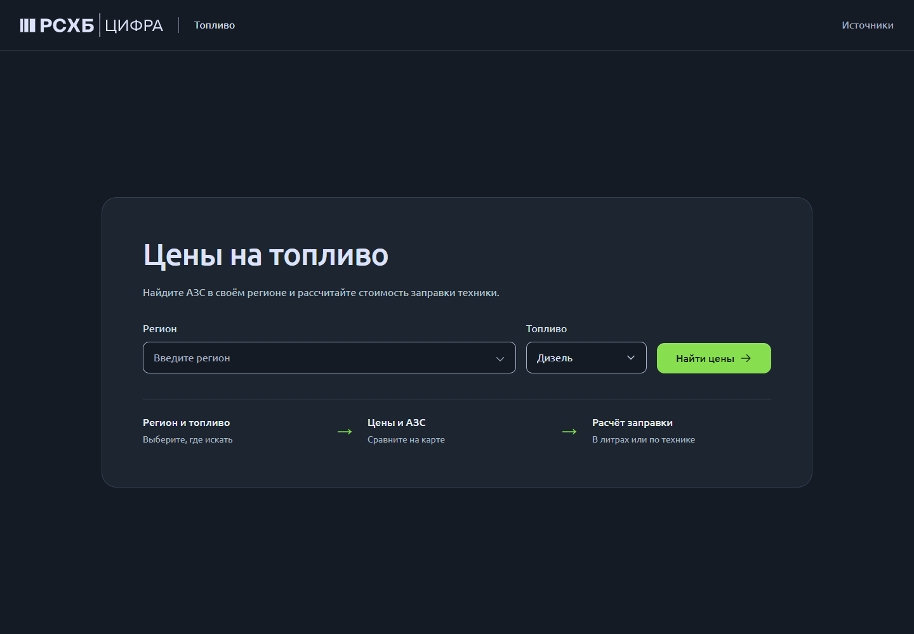
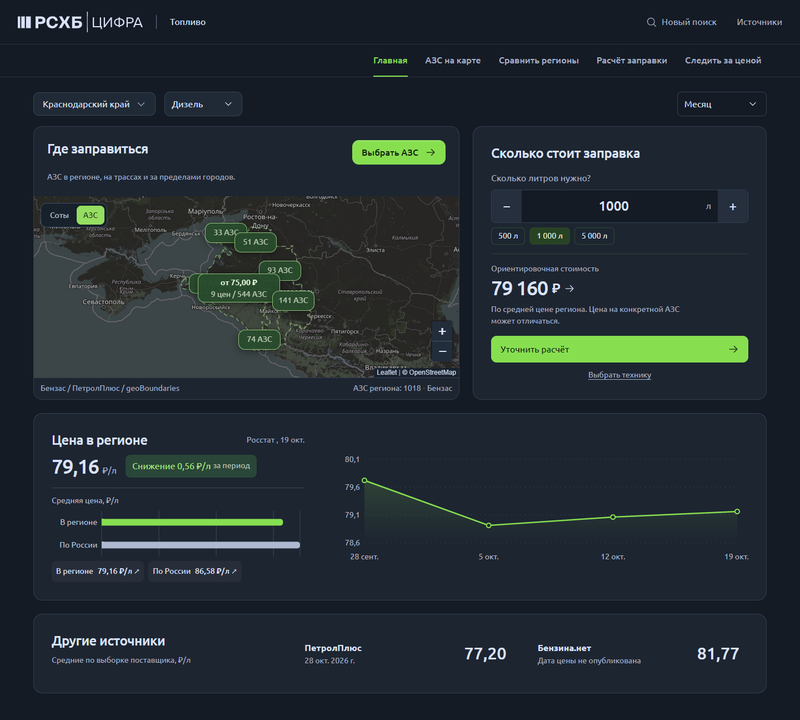
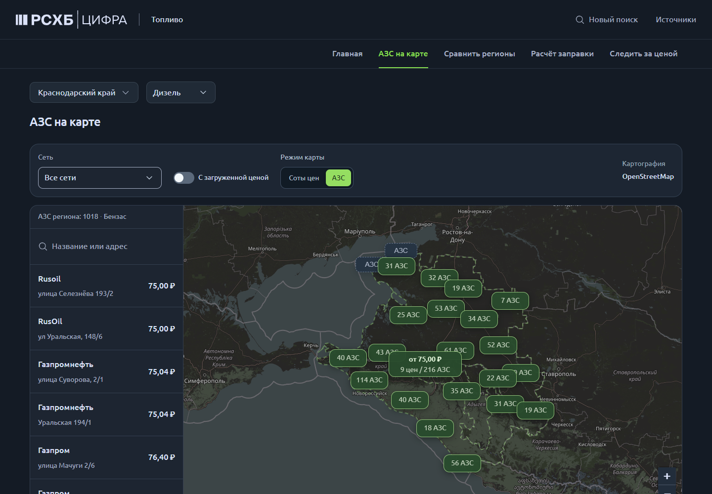
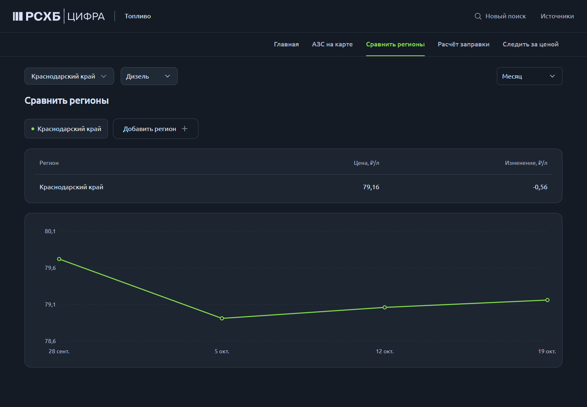
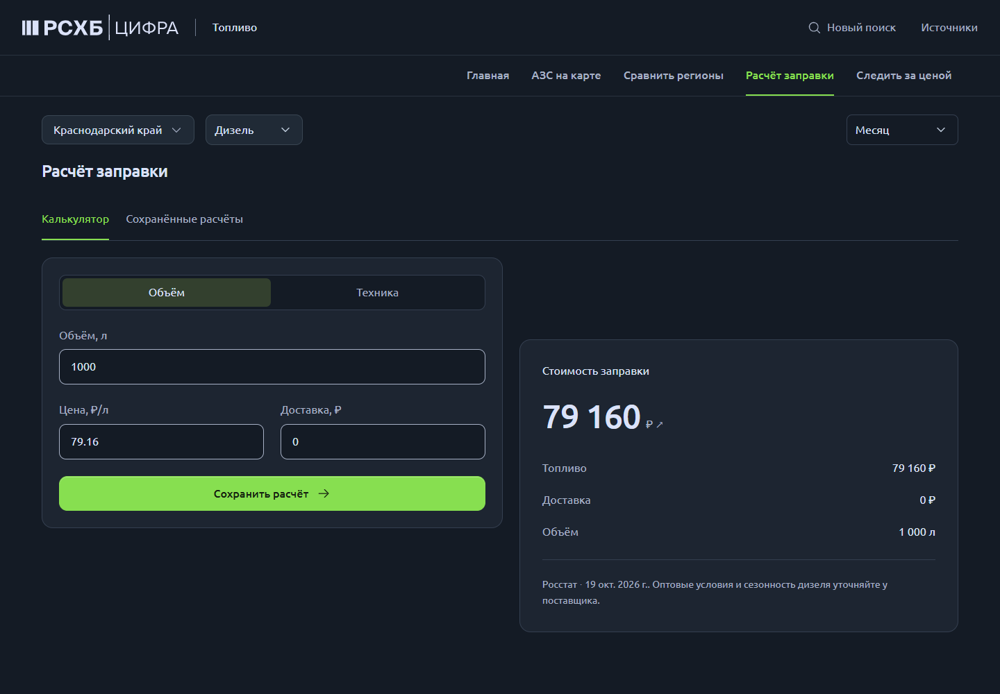

# АгроТопливо

Региональный сервис мониторинга топлива для сельхозтехники. Выбор региона и топлива, АЗС по территории региона, сравнение динамики, расчёт заправки и закупки.

Учебная работа в визуальном стиле РСХБ. Не официальный продукт Россельхозбанка; права на знаки принадлежат их владельцам.

## Интерфейс







[PDF презентации](docs/presentation/agrofuel.pdf) · [LaTeX](docs/presentation/main.tex)

## Быстрый запуск

Node.js 22 или новее. В двух терминалах:

```sh
npm ci
npm run api
```

```sh
npm run dev
```

`npm test` проверяет расчёты, источники и агрегацию H3. `npm run build` собирает приложение. Для Vercel серверный обработчик размещён в `api/[...path].js`; отдельный постоянно работающий сервер не требуется.

## Дополнительные источники

Добавлены 295 региональных значений для 77 регионов: ПетролПлюс (231) и Бензина.нет (64). Покрытие конкретного топлива меньше. Их методика и дата отличаются от Росстата, поэтому индексы показаны отдельными строками. Даты отсутствующих наблюдений не выдумываются; нули исключаются. Это снимок от 29 октября 2026 года, автоматического обновления нет. Для сверки откройте карточку источника.

- [ПетролПлюс](https://www.petrolplus.ru/fuelindex/) — средние по выборке транзакций.
- [Бензина.нет](https://www.benzinanet.com/ceny/) — средние по каталогу АЗС. Городские строки не подставляются вместо региона.
- [Росстат](https://rosstat.gov.ru/) — официальная динамика в основном графике.
- [Бензас](https://benzas.ru/) — координаты и доступные цены конкретных АЗС по запросу.

## Дизайн и картография

Применены Hallmark (app screen) и Landing Page Design: единые токены цвета, шкала размеров и отступов, Phosphor, состояния элементов и уменьшение движения. Ubuntu и палитра РСХБ сохранены по исходному заданию. Маркетинговые секции и слоганы исключены.

Подложка OpenStreetMap, затемнённая CSS-фильтром. Атрибуция OpenStreetMap сохранена. Границы geoBoundaries 2017 года приблизительные; для некоторых территорий недоступны. У крупных регионов загружается видимая область после приближения. Подложка и источники зависят от доступности внешних серверов. Публичные тайлы OSM рассчитаны на умеренную нагрузку; массовая выгрузка и офлайн-кеширование не предусмотрены.

История региональных средних сохранена; у отдельной АЗС история может состоять из одной точки. Нет искусственной интерполяции. Правила наблюдения и расчёты сохраняются в браузере, автоматическая рассылка не подключена.

## Технологии

React 19, TypeScript, Vite, Recharts, Leaflet, H3, Node.js. Компоненты 21st.dev адаптированы к рабочему сценарию; ссылки и авторство в исходниках. Карта загружается отдельным модулем. Доступна сборка Docker / Nginx через `docker compose up --build`.

## Ссылки

- [Открыть сервис](https://agrofuel-artyomkorotkov2019-6469s-projects.vercel.app)
- [Презентация PDF](docs/presentation/agrofuel.pdf)
- [Исходный LaTeX](docs/presentation/main.tex)
